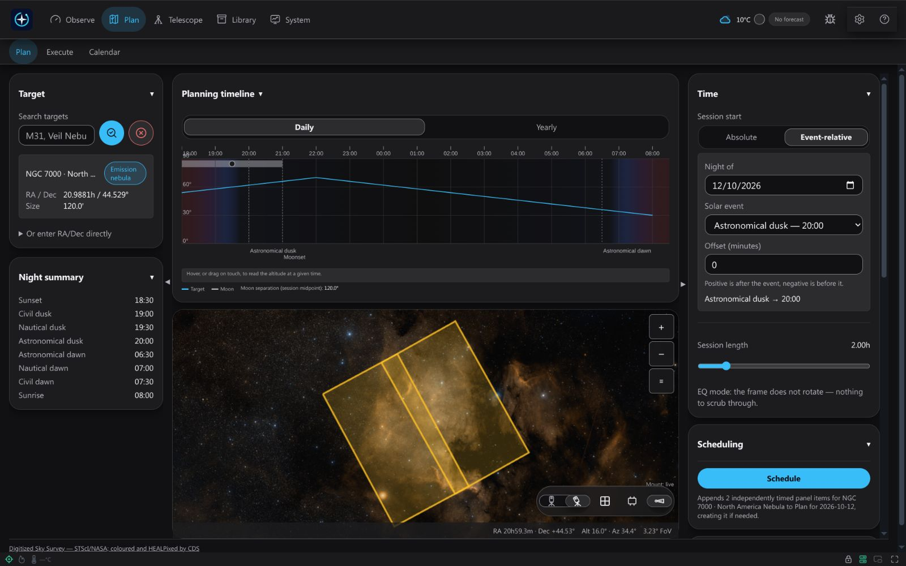
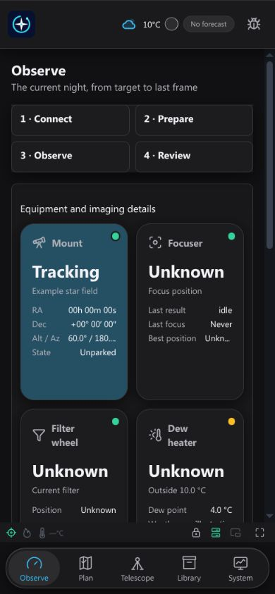

# Photon Commander

Free, complete observatory control and imaging software by **Miroslav Bakoš**.
The application source is licensed under **GPL-3.0-only**. There are no paid
feature tiers or application expiry gates. Third-party code and data retain
their own licences and attribution; see [THIRD_PARTY_NOTICES.md](THIRD_PARTY_NOTICES.md).

## Make the most of your observing night

- **Reach your telescope from anywhere with Tailscale.** Use your phone or
  computer over a private connection, without opening router ports. Tailscale's
  [free Personal plan](https://tailscale.com/pricing) covers personal,
  non-commercial use; both devices need internet access and Tailscale setup.
- **Share your live stack on YouTube.** Stream the developing image as frames
  accumulate, using FFmpeg and your YouTube Live account.
- **Spend clear skies collecting lights, not repeating darks.** Prepare reusable
  calibration masters and schedule dark acquisition outside your valuable light
  window. Photon checks matching capture settings and calibration suitability
  before reuse; a stored dark is not automatically suitable for every session.
- **Choose how many darks go into your master.** Configure the frame count
  instead of being limited to five darks in Seestar workflows that use that
  fixed count. Capture larger sets when useful and keep them in your calibration
  library. The manufacturer's workflow can differ by model and firmware.
- **See what each polar-alignment measurement means for exposure.** Each new
  measurement updates the estimated subexposure limit for polar-alignment drift
  with the supported camera profile. It helps you judge when alignment is good
  enough; tracking, wind, seeing, focus and field rotation still affect stars.
- **Switch between desktop and mobile while Photon keeps observing.** The
  server owns the session and observing state; paired browsers show the same
  application with a layout adapted to their screen. Each device needs access
  to the same server and the appropriate viewing or control permission.



*The complete Photon Commander window, planning a two-panel mosaic across
NGC 7000 with DSS2 enabled. Settings and status are illustrative; this is a
framing preview, not a captured observation.*

<details>
<summary>DSS2 image credits and usage terms</summary>

DSS2 colour — Digitized Sky Survey, STScI/NASA; coloured and HEALPixed by
CDS Aladin Sky Atlas, Unistra/CNRS. Plates © STFC/ROE, Anglo-Australian
Observatory Board, Caltech and AURA — All Rights Reserved. Free for
research, teaching and other non-profit use; commercial, for-profit use
prohibited without written permission. See the
[MAST data-use policy](https://archive.stsci.edu/publishing/data-use).
HiPS database: ODbL-1.0. Survey pixels are excluded from the application's
GPL licence and from the application installers.

</details>

## Mobile access

The same application on a phone — observing status and equipment details:



This interface example uses fictional settings and status;
it does not represent a hardware-validation result.

## Platforms

Photon is designed for **Raspberry Pi, Windows, Linux and macOS**, with desktop
and mobile browsers as clients. The current 0.0.1 package targets are Windows
x64 and Raspberry Pi 5 ARM64; their release validation is in progress. Linux
desktop and macOS users can work from source using the instructions below.
Native macOS packages and macOS runtime validation are not yet available.

## Support development

[](https://www.paypal.com/donate/?business=7TG8WFWH5K79Y&no_recurring=0&item_name=for+Photon+Commander+development+and+support+for+new+devices&currency_code=EUR)

Donations help fund continued development and equipment for adding support for
new devices. Support is voluntary; Photon Commander remains free.

## Features

- Smart telescope control through ASCOM Alpaca, discovery and device status.
- Observation planning, scheduling, historical night reports and persisted recovery.
- Image capture, calibration masters, quality measurements and live stacking.
- Autofocus, polar alignment, target centring and equipment profiles.
- Sky maps, framing, catalogues, weather and observing conditions.
- Optional FFmpeg video streaming, plate solving and external integrations.

Capability and telemetry availability depend on the connected equipment. Unknown
or unavailable measurements are reported rather than invented.

## Install, start and configure

Choose your language for installation, the eight-step setup wizard, first
observations, updates and troubleshooting:

| Language | Illustrated guide | Windows | Raspberry Pi 5 |
| --- | --- | --- | --- |
| English | [Getting started](docs/getting-started.en.md) | [Installation](docs/installation/windows.en.txt) | [Installation](docs/installation/pi.en.txt) |
| Slovenčina | [Začíname](docs/getting-started.sk.md) | [Inštalácia](docs/installation/windows.sk.txt) | [Inštalácia](docs/installation/pi.sk.txt) |
| Čeština | [Začínáme](docs/getting-started.cs.md) | [Instalace](docs/installation/windows.cs.txt) | [Instalace](docs/installation/pi.cs.txt) |

The illustrated guides show setup, equipment, polar alignment, capture,
planning, live stacking and the image library. Screenshots use fictional
settings and illustrative data; they do not represent hardware test results.

[](docs/getting-started.en.md#interface-examples)

## Build and develop

Use Python **3.12**, `uv`, and Node.js **22 or later** with npm.

```sh
uv sync --dev --frozen
npm --prefix web ci
npm --prefix web run typecheck
npm --prefix web run build
```

Obtain the JPL DE440s ephemeris kernel separately from NASA/JPL:
<https://naif.jpl.nasa.gov/pub/naif/generic_kernels/spk/planets/de440s.bsp>.
Store it at `data/ephemeris/de440s.bsp`. It is required for astronomy calculations
and the packaging scripts. No kernel download is performed by the application
build. Keep its upstream provenance and assess applicable distribution terms.

**Survey tile packs and user caches are not included in this source repository.**
Current packaging checks require a local
WHAM H-alpha HiPS pack at `data/hips/wham/`. Acquire the input and assess applicable
rights before using `scripts/build-wham-hips.py --source <local-source.fits>` to
generate it. The source recipe, upstream information and acknowledgements are
retained. Source licensing and credits do not establish WHAM redistribution rights.
The H-alpha layer remains unavailable without that separately provided asset;
packaging refuses an incomplete asset set rather than silently omitting it.

DSS2 is fetched only subject to its user consent and applicable personal-use
restrictions. The credited README illustration contains DSS2 pixels; it is
excluded from application installers and the application's GPL licence.
User caches and observing data are not distributed here. GPL licensing does
not grant survey image rights.

After providing the required local assets, build a backend bundle with
`scripts/build-package.sh`; native platform package scripts are under `scripts/`.
Use their `--help` output for the platform and immutable Git revision requirements.
`npm --prefix web run api:codegen` regenerates the OpenAPI TypeScript contract
without connecting to equipment.

For local use, build the frontend and run `scripts/run-dev.sh`; open the pairing
URL printed by the application. Weather providers require the user's own contact
or server-side keyring credentials. ASTAP and its database are installed separately;
optional video streaming requires FFmpeg. No credentials are supplied.

## Checks

```sh
uv run pytest
uv run ruff check ssc tests scripts
uv run mypy ssc
npm --prefix web run test
npm --prefix web run typecheck
```

Historical owner observations, recorded hardware traces, private deployment tests
and their dependent tests are intentionally excluded. The retained tests use
synthetic fixtures and public astronomy reference data. Ephemeris and locally
provided WHAM checks need their respective assets. No physical telescope is
required for ordinary offline tests.

## Licences and credits

Copyright (C) 2026 Miroslav Bakoš. See [LICENSE](LICENSE) for GPLv3 terms.
Required library licence texts and matching weak-copyleft source archives are
preserved under `packaging/third-party-licenses/` and
`packaging/third-party-sources/`. Astronomy datasets retain their own notices.
This directory is a private preparation candidate, not a published release.

## Optional background

The decorative M31 background is disabled by default. To use it in a local build, place an image you own or have permission to redistribute at `web/public/backgrounds/m31.webp`, then enable the background in Appearance. No third-party or personal photograph is included.
