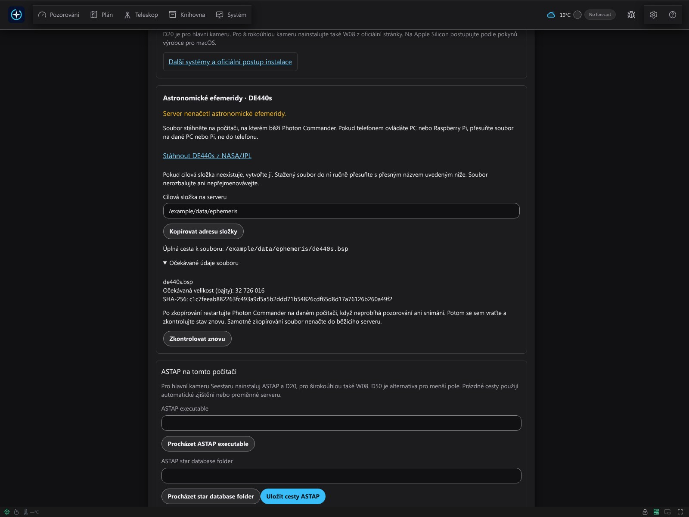
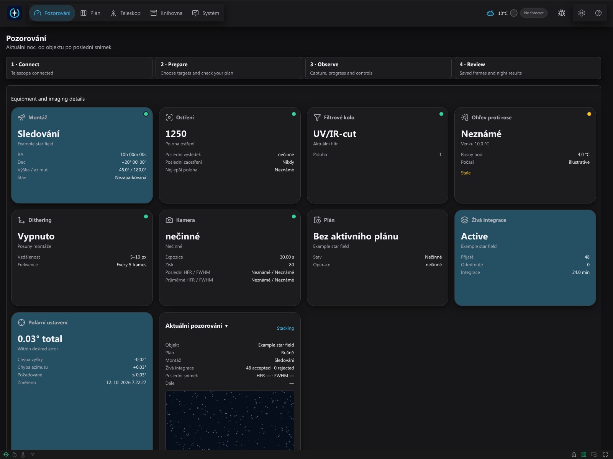
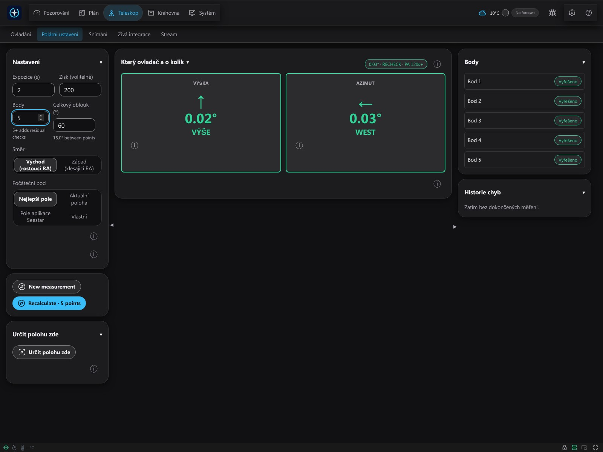
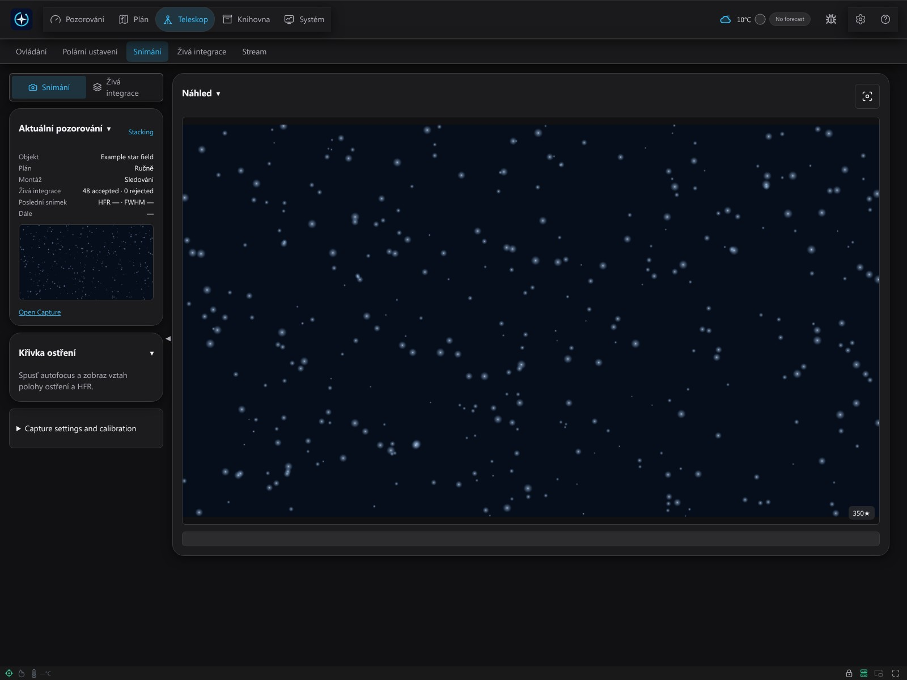
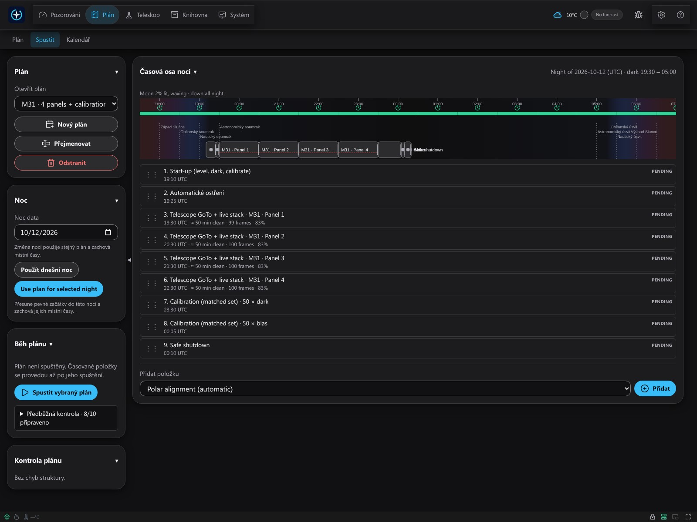
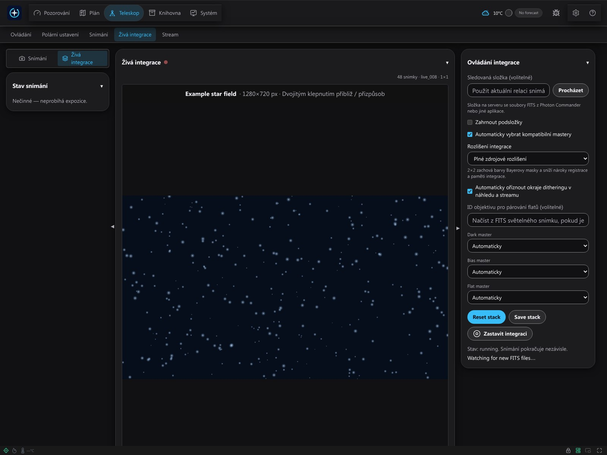
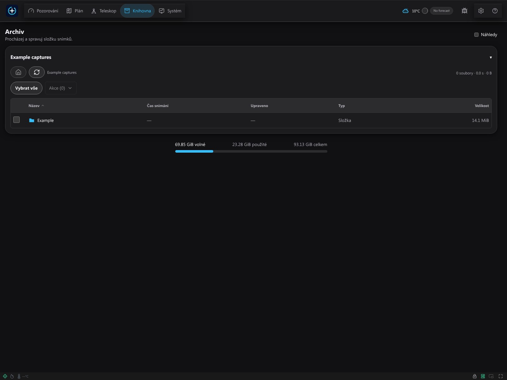

# Začínáme s Photon Commander 0.0.1

Návod je určen pro první soukromá sestavení Windows x64 a Raspberry Pi 5 ARM64. Photon Commander je jedna úplná bezplatná aplikace od Miroslava Bakoše. Návod ani snímky obrazovky nepotvrzují kompatibilitu každého systému, firmwaru nebo výsledky fyzického pozorování. Toto vydání nenabízí instalátor pro macOS.

## Instalace, spuštění a údržba

Použijte [návod pro Windows](installation/windows.cs.txt) nebo [Raspberry Pi](installation/pi.cs.txt). Před instalací ověřte dodaný kontrolní součet SHA-256. Před aktualizací zastavte snímání, ukončete Photon a zálohujte nastavení i snímky. Odinstalování zachová uvedenou datovou složku. Zálohujte také snímky uložené v jiné vybrané složce.

Windows: spusťte dodaný instalátor pro svůj účet, otevřete zástupce a http://127.0.0.1:7777. Zavření konzole backendu zastaví Photon. Raspberry Pi: nainstalujte ARM64 DEB na podporovaný 64bitový systém a otevřete http://PI-IP:7777. PI-IP nahraďte skutečnou adresou serveru Photon, nikoli dalekohledu. Běžný balíček používá systémovou službu a /var/lib/photon-commander. Nekombinujte jej s cestami samostatného balíčku pro SSD zařízení.

## Průvodce: osm kroků

Otevřete **Průvodce nastavením**. Před tlačítkem **Další** použijte **Uložit** v každém panelu. Potvrzení kontroly ukládá postup pouze v tomto prohlížeči; neověřuje připravenost hardwaru. Nedokončený postup můžete obnovit.

**Upozornění na firmware:** před aktualizací Seestar požádejte podporu Photon o potvrzení modelu, navrhovaného firmwaru a verze Photonu. Nekompatibilní aktualizace může natrvalo znemožnit připojení nebo provoz, pokud ji nelze vrátit. Nalezení zařízení samo nepotvrzuje kompatibilitu.

### 1. Jazyk

1. Vyberte English, Slovenčina nebo Čeština.
2. Ověřte, že rozumíte ovládání, a pokračujte.

### 2. Síť a Station Mode

1. Zapněte dalekohled a připojte se oficiální aplikací Seestar.
2. Otevřete Wi-Fi nastavení zařízení, zapněte Station Mode a vyberte směrovač.
3. Heslo Wi-Fi zadejte **pouze v aplikaci výrobce** a připojte se.
4. Telefon připojte zpět ke směrovači. Server Photon i dalekohled musí být ve stejné LAN.

Obrázky aplikace výrobce jsou v [oficiálním návodu](https://www.seestar.com/blogs/tutorial/use-station-mode-screen-mirroring-seestar). Nabídky, pásma Wi-Fi a Ethernet závisí na modelu/firmwaru; pro jiné zařízení použijte jeho návod.

### 3. ASCOM Alpaca

1. V aplikaci nebo návodu výrobce najděte ASCOM Alpaca nebo ovládání třetí stranou.
2. Zapněte je, pokud je model a firmware nabízejí. Neexistuje stejný přepínač pro všechna zařízení.
3. Pokud vybavení potřebuje externí most Alpaca, nastavte a spusťte jej samostatně.
4. Vraťte se do Photonu a přečtěte stav zařízení.

### 4. Vyhledání a připojení

1. Prohledejte LAN a vyberte skutečně nalezené zařízení.
2. Otestujte adresu a výslovně stiskněte **Připojit**.
3. Vyberte nabízenou kameru, montáž a další zařízení Alpaca.
4. Ověřte připojení, čerstvou polohu a upozornění na schopnosti.

Pokud hledání nic nenajde, ověřte napájení, LAN a izolaci klientů směrovače. Podle potřeby zadejte skutečnou adresu ručně. Neznámé nebo neaktuální hodnoty nejsou podkladem pro pohyb.

### 5. Vybavení

1. Vyberte podporovaný model a optiku odpovídající vybavení.
2. Přečtěte parametry profilu, stav kalibrace a upozornění.
3. Uložte změny; připojení samo nepotvrzuje všechny funkce.

### 6. Pozorovací místo

1. Najděte skutečné místo dalekohledu na veřejné mapě, například [Google Maps](https://support.google.com/maps/answer/18539?hl=cs).
2. Připněte bod nebo klikněte pravým tlačítkem a přečtěte desetinné souřadnice.
3. Zadejte nejprve šířku, potom délku; zachovejte minus. Nepoužívejte polohu telefonu, pokud je dalekohled jinde.
4. Nastavte výšku, časové pásmo a horizont. Uložte a ověřte místní i letní čas.

### 7. Složky snímků

1. Vyberte složku na počítači se serverem Photon, ne na telefonu.
2. Ověřte zápis a volné místo a stiskněte **Uložit**.
3. Pro systémovou službu Pi použijte /var/lib/photon-commander/captures; domovské složky blokuje ochrana služby. Příkaz k vytvoření je v [návodu Pi](installation/pi.cs.txt).

### 8. ASTAP a hvězdné databáze

1. Oficiální odkazy otevřete **na serveru Photon**.
2. Nainstalujte správný ASTAP a D20; pro širokoúhlou kameru také W08.
3. Uložte cesty programu/databáze a ověřte zjištěný stav.
4. Zkontrolujte panel DE440s. Pokud soubor chybí, použijte přesnou cílovou cestu serveru a restartujte pouze mimo pozorování/snímání.
5. Znovu ověřte stav. Dokončení kontroly neprovede řešení polohy ani automaticky nenačte zkopírovaný soubor.

Následující část vysvětluje databáze a rozdíl zdrojové a zabalené verze.

## ASTAP a astronomická data

Na server nainstalujte [ASTAP a databáze](https://www.hnsky.org/astap.htm) z [oficiálního adresáře](https://sourceforge.net/projects/astap-program/files/). Vyberte Windows x64 nebo Linux ARM64, D20 pro hlavní kameru a W08 pro širokoúhlou kameru. Samotný ASTAP nestačí. V průvodci uložte cestu programu a databáze a ověřte zjištěný stav. Proměnné služby SSC_ASTAP_CLI a SSC_ASTAP_DATA_DIR patří do /etc/photon-commander/environment; po změně restartujte službu. Při desktopovém spuštění zavřete a znovu spusťte backend. Skutečné řešení polohy vyžaduje vhodný snímek.

Panel DE440s v kroku 8 ukazuje, zda běžící server načetl soubor. Při stavu Připraveno nic nestahujte. Jinak použijte zobrazenou **Cílovou složku na serveru** a **Úplnou cestu k souboru**; Kopírovat adresu složky kopíruje cíl serveru, ne telefonu. Soubor zkopírujte s přesným názvem, restartujte nečinný backend a stiskněte **Zkontrolovat znovu**.

Zdrojová verze vyžaduje [NASA/JPL DE440s](https://naif.jpl.nasa.gov/pub/naif/generic_kernels/spk/planets/de440s.bsp) v data/ephemeris/de440s.bsp vzhledem ke kořeni repozitáře. Stáhněte soubor na server před spuštěním, nikoli na telefon. Sestavené balíčky jej vyžadují při balení a obsahují jej; nepatří do složky snímků. Pokud chybí nebo je poškozen, použijte přesnou cestu uvedenou v chybě serveru, opravte instalaci nebo balíček sestavte se správným vstupem a restartujte Photon. Astronomický výpočet jej nestahuje automaticky. Práva k mapovým snímkům jsou samostatná; omezení DSS potvrďte pouze při odpovídajícím povoleném použití.

## První pozorování

Před pohybem ověřte stativ, prostor, napájení, počasí a nezávislé zastavení zařízení. Obrázek ani uložený profil nejsou důkazem fyzického zarovnání nebo bezpečného provozu.

### A. Zarovnání

1. Otevřete Zarovnání a vyberte postup podporovaný montáží a režimem.
2. Postupujte měřením polárního zarovnání a čtěte výsledek i chyby každého kroku.
3. Proveďte uvedené fyzické úpravy a podle požadavku měření zopakujte.
4. Pokračujte až po kontrole vlastního výsledku; ilustrační obrázek nenahrazuje měření.

### B. První plán

1. Otevřete Plánování a vyberte cíl z katalogu nebo jej zadejte dostupným ovládáním.
2. Ověřte vybavení, optiku, datum a čas pozorování.
3. Upravte kompozici a případné panely mozaiky; zkontrolujte horizont, rotaci a upozornění.
4. Uložte plán, otevřete Plánování časové osy a vyberte uložený plán a noc.
5. Sestavte a přečtěte časovou osu. Před spuštěním ověřte položky, odhadovaná okna a nesplněné podmínky.
6. Výslovně spusťte pouze zkontrolovaný plán. Sledujte průběh a podle potřeby použijte zastavení. Uložení ani sestavení nespouštějí pozorování.

### C. První snímek

1. Otevřete Snímání a ověřte vybranou kameru a serverovou složku.
2. Nastavte požadovaný filtr, zesílení a délku expozice.
3. Spusťte jednu expozici a počkejte na výsledek. Zkontrolujte chyby i vznik uloženého snímku.
4. Prohlédněte snímek před opakovanou sérií. Před fyzickou změnou vybavení nebo aktualizací sérii zastavte.

### D. Živé skládání

1. Otevřete Živé skládání a zkontrolujte cíl, vstup a možnosti.
2. Výslovně je zapněte nebo spusťte dostupným ovládáním; uložený snímek sám neznamená, že skládání běží.
3. Sledujte přijaté a odmítnuté snímky i integraci. Neznámá kvalita nebo neaktuální hodnoty nejsou úspěšným měřením.
4. Po dokončení zastavte snímání a výsledek před exportem prohlédněte.

### E. Knihovna a historie

1. Otevřete Knihovnu a vyberte uložený snímek nebo relaci.
2. Prohlédněte náhled a zaznamenanou kvalitu; exportujte jen zamýšlený výběr.
3. Před odstraněním ověřte vybrané soubory a uchovejte zálohu potřebných originálů.
4. V Kalendáři čtěte zaznamenaná provedení. Historie používá původní provedený plán, ne pozdější úpravy.

## Telefon a vzdálený přístup

Ve stejné LAN otevřete zobrazenou adresu serveru nebo http://photon.local:7777 pouze tehdy, pokud je název skutečně oznamován a funguje; jinak použijte skutečnou LAN adresu. photon.local je lokální název mDNS, nikoli internetová adresa. Desktopový balíček Windows je ve výchozím stavu pouze místní; telefon potřebuje výslovně nastavený server dostupný v LAN. Spárujte prohlížeč zobrazeným QR kódem nebo odkazem a podle nastavení zadejte ovládací PIN. Relace pouze pro čtení nemůže ovládat zařízení.

Mimo LAN nainstalujte [Tailscale](https://tailscale.com/download) na server i telefon, připojte je do povolené sítě a podle Nastavení → Vzdálený přístup nastavte soukromé HTTPS přes [Tailscale Serve](https://tailscale.com/docs/features/tailscale-serve). Photon pouze čte stav; nepřihlašuje účet ani nemění pravidla. Pro běžné ovládání nepřesměrovávejte porty směrovače a nepoužívejte veřejný Funnel. Zachovejte nezávislou možnost místního zastavení nebo odpojení napájení.

## Problémy a hlášení

Pokud stránka nefunguje, ověřte backend, adresu, port a firewall; port 7777 může obsadit druhý backend. Pi: journalctl -u photon-commander -n 100 --no-pager. Windows: konzole backendu. U chybějících snímků ověřte složku serveru a místo, u ASTAP databázi a optiku, u počasí poskytovatele a odemčenou systémovou klíčenku serveru. Zastaralá předpověď ani poslední údaj nejsou aktuálním stavem.

Přes ikonu chyby popište postup, přečtěte připravené hlášení a před Odeslat výslovně potvrďte souhlas. Strukturovaná diagnostika vynechává přihlašovací údaje, snímky a polohu/nastavení; vlastní text, obrázky a ruční přílohy nejsou automaticky anonymizovány. Odstraňte jména, adresy, souřadnice, PINy, klíče a soukromá pozorování. Pokud doručení selže, stáhněte hlášení. Odeslání nepotvrzuje správnost hardwaru.

## Ukázky rozhraní

Jde o snímky skutečného rozhraní Photon Commander s fiktivními nastaveními a ilustračními odpověďmi API. Hvězdné pole bylo vytvořeno pro tyto ukázky. Hodnoty zarovnání, plány, počasí a počty snímků jsou ilustrační údaje, nikoli zaznamenaná měření nebo důkaz fyzického výkonu. Cesty složek jsou příklady; použijte cíl zobrazený vaším serverem.

### Průvodce nastavením

Existující krok s nástroji obsahuje stažení DE440s, cílovou složku, kontrolní údaje a pokyny k ručnímu restartu.

### Přehled a zařízení

Přehled ukazuje ilustrační stav připojených zařízení; nejde o živé hardwarové spojení.

### Polární zarovnání

Běžné rozhraní zarovnání ukazuje ilustrační korekce a vyřešené body, nikoli skutečné měření.

### Snímání

Náhled uloženého snímku zobrazuje syntetické hvězdné pole bez údajů vlastníka a mapových pixelů.

### Časová osa plánu

Ilustrační sekvence čtyř panelů mozaiky obsahuje kalibraci dark a bias; žádný plán se neprovedl.

### Živé skládání

Ilustrační aktivní skládání ukazuje syntetické pixely a příkladové počty; neproběhlo žádné snímání.

### Knihovna snímků

Knihovna používá fiktivní názvy souborů, záznamy snímků a hodnoty úložiště.
