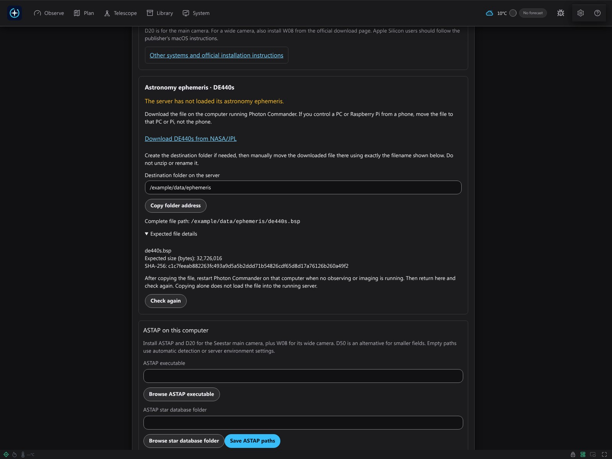
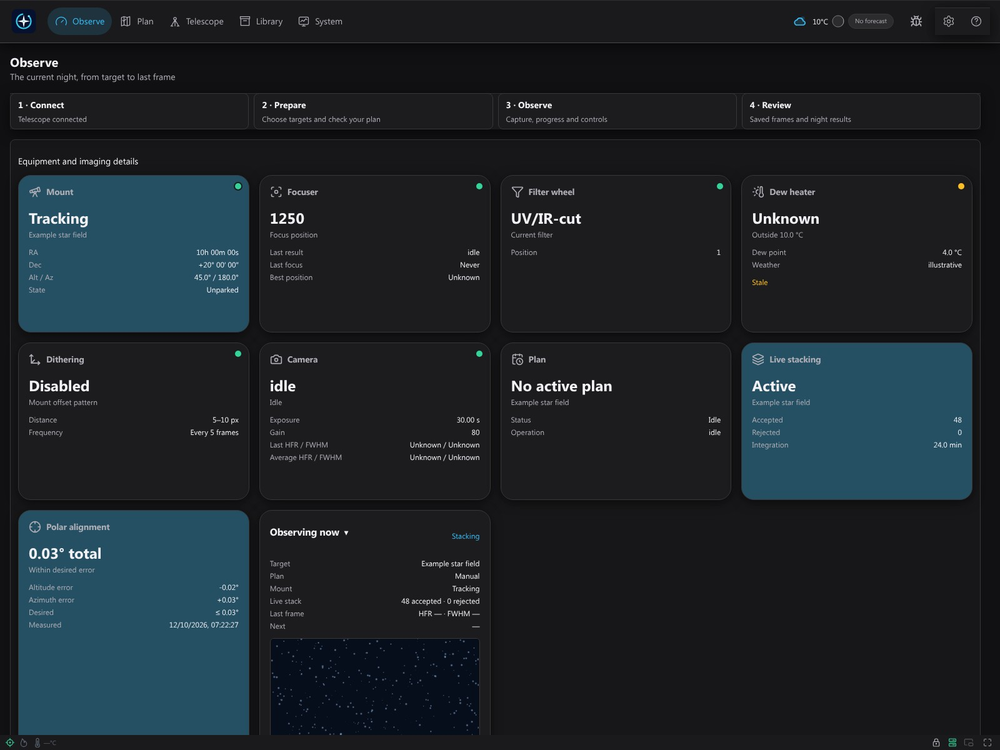
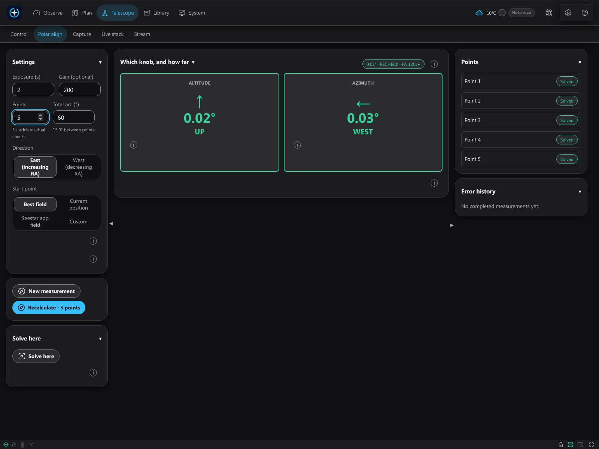
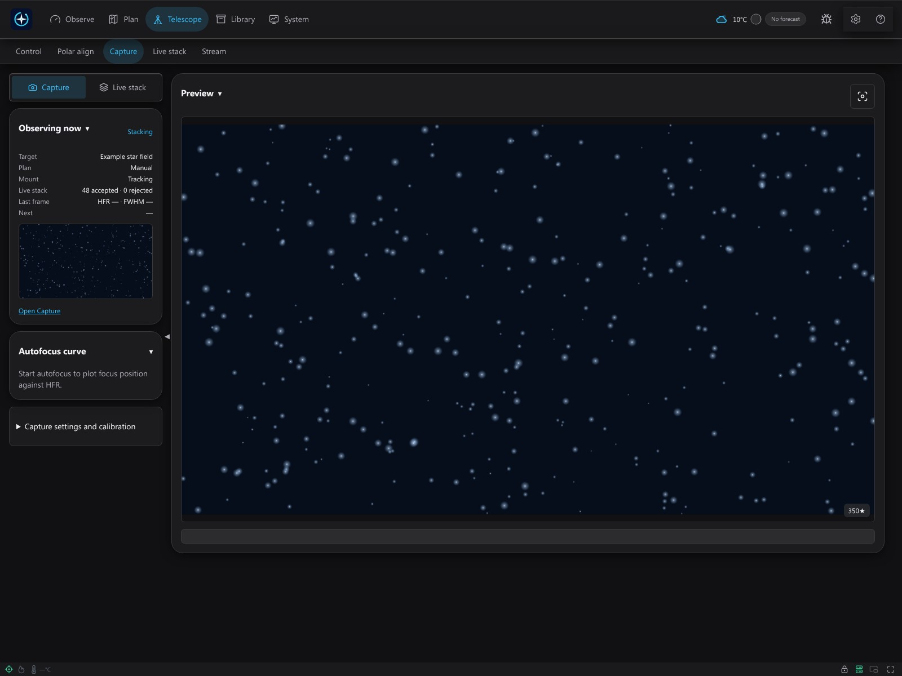
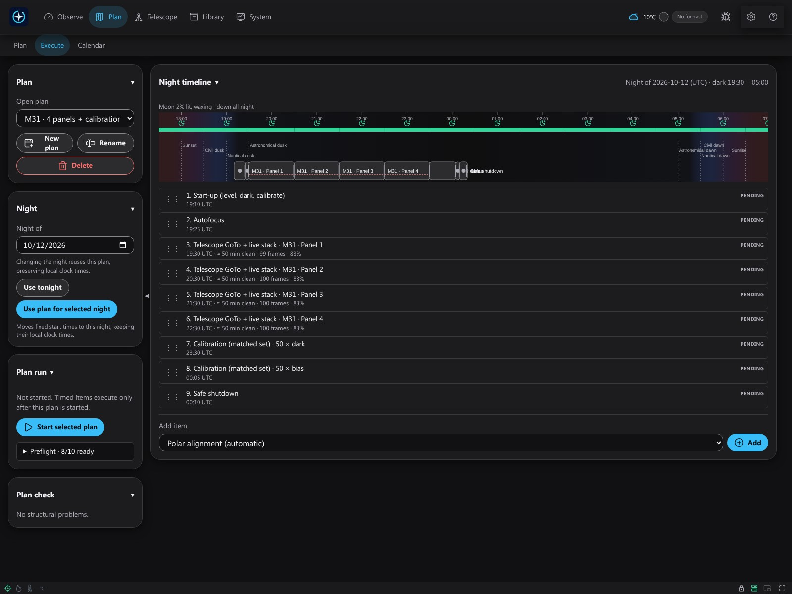
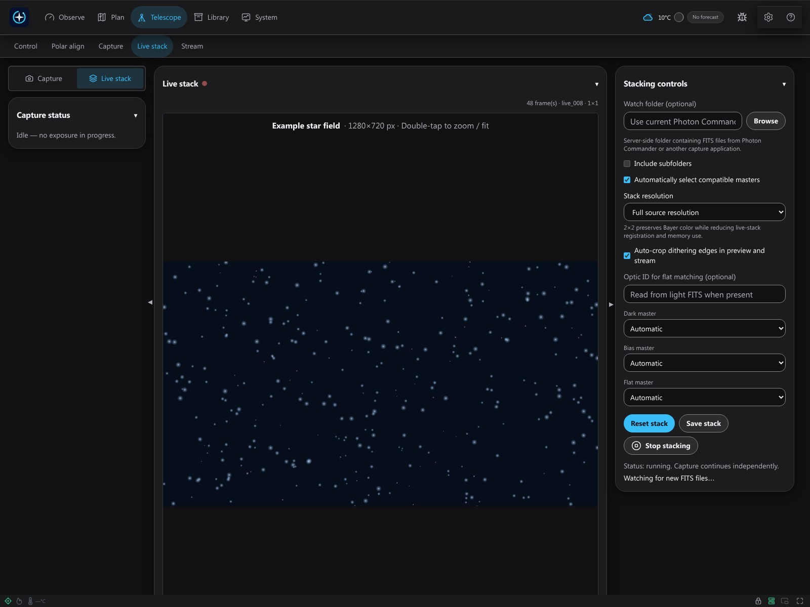
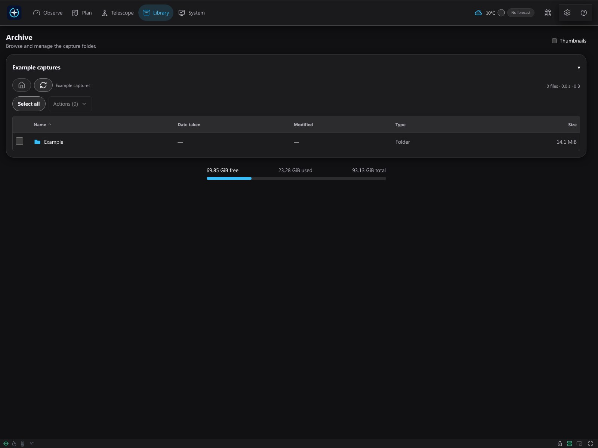

# Getting started with Photon Commander 0.0.1

This guide covers the first private Windows x64 and Raspberry Pi 5 ARM64 builds. Photon Commander is one complete free application by Miroslav Bakoš. Instructions and screenshots do not certify installation on every system, firmware compatibility or physical observing performance. No macOS installer is supplied by this release.

## Install, launch and maintain

Choose the [Windows guide](installation/windows.en.txt) or [Raspberry Pi guide](installation/pi.en.txt). Verify the supplied SHA-256 checksum before installation. Close Photon and stop captures before updating; back up settings and captured files. Installer removal preserves the documented user-data directory. Keep images stored in a separately chosen capture folder in your backup too.

Windows: run the supplied setup for your account, launch the shortcut and open http://127.0.0.1:7777. Closing the backend console stops Photon. Raspberry Pi: install the ARM64 DEB on the supported 64-bit system and open http://PI-IP:7777, replacing PI-IP with the host's actual address. This is the Photon host, not the telescope. The generic package runs a system service and stores data in /var/lib/photon-commander. Do not substitute appliance SSD paths.

## Guided setup: eight steps

Open **Guided setup**. Save changes using the **Save** button in each panel before clicking **Next**. The review acknowledgement records progress in this browser; it does not verify hardware readiness. Resume unfinished setup when needed.

**Firmware warning:** before updating Seestar firmware, ask Photon support to confirm your model, proposed firmware and Photon version. An incompatible update may prevent connection or operation permanently if it cannot be reverted. Discovery alone does not establish compatibility.

### 1. Language

1. Select English, Slovenčina or Čeština.
2. Check that you can read the controls, then continue.

### 2. Network & Station Mode

1. Power on the telescope and connect using the official Seestar app.
2. Open the device's Wi-Fi settings, enable Station Mode and select your router.
3. Enter the Wi-Fi password **only in the manufacturer's app** and connect.
4. Reconnect the phone to the router. Keep the Photon host and telescope on the same LAN.

Use the [official Station Mode guide](https://www.seestar.com/blogs/tutorial/use-station-mode-screen-mirroring-seestar) for vendor screenshots. Menus, Wi-Fi bands and Ethernet support vary by model/firmware; other devices follow their manufacturer's guide.

### 3. ASCOM Alpaca

1. In the manufacturer's app/manual, find ASCOM Alpaca or third-party control.
2. Enable it if your model and firmware offer it. There is no universal switch shared by every device.
3. If your equipment needs an external Alpaca bridge, configure and start it separately.
4. Return to Photon and read the reported device status.

### 4. Discover & connect

1. Scan the LAN and select the actual detected device.
2. Test its address, then explicitly press **Connect**.
3. Select the available camera, mount and other Alpaca devices as offered.
4. Check connection status, fresh position readings and capability warnings.

If discovery is empty, check power, LAN membership and router client isolation. Enter the actual device address manually when needed. Unknown or stale readings are not a safe basis for motion.

### 5. Equipment

1. Choose the supported model and optic that match your equipment.
2. Review the profile parameters, calibration status and capability warnings.
3. Save changes; do not assume connection validates all functions.

### 6. Observing site

1. Find the telescope's actual site on a public map, such as [Google Maps](https://support.google.com/maps/answer/18539?hl=en).
2. Drop a pin or right-click the site to read decimal coordinates.
3. Enter latitude first and longitude second; keep minus signs. Do not substitute your phone's location when the telescope is elsewhere.
4. Set elevation, timezone and horizon. Save and check local time/daylight-saving behavior.

### 7. Capture folders

1. Choose a folder on the computer running Photon, not on the controlling phone.
2. Confirm write permission and free space, then **Save**.
3. For the Pi system service, use /var/lib/photon-commander/captures; home folders are blocked by service protections. The [Pi guide](installation/pi.en.txt) gives the creation command.

### 8. ASTAP & star databases

1. Open the official download links **on the Photon host**.
2. Install the matching ASTAP program and D20 database; add W08 for a wide camera.
3. Save executable/database paths and check the detected status.
4. Check the DE440s panel. If it is missing, follow its exact server destination, then restart only when no observing/imaging is running.
5. Return and check again. Finishing review does not perform a plate solve or load a copied kernel automatically.

The next section explains program/database and source-versus-bundled kernel handling.

## Solver and astronomy data

Install [ASTAP and star databases](https://www.hnsky.org/astap.htm) on the Photon host. The publisher's [download directory](https://sourceforge.net/projects/astap-program/files/) provides platform packages. Install the matching Windows x64 or Linux ARM64 program, D20 for the main camera, and W08 for a wide camera. ASTAP alone is insufficient. Save executable/database paths in the setup step and verify the detected status. Linux service overrides SSC_ASTAP_CLI and SSC_ASTAP_DATA_DIR belong in /etc/photon-commander/environment; restart the service after changing its environment. Desktop environment changes require closing and reopening the backend. Solving success still requires an actual suitable frame.

In step 8, the DE440s panel shows whether the running server has loaded the kernel. If Ready, no download is needed. Otherwise, use **Destination folder on the server** and **Complete file path** shown there; Copy folder address copies the server destination, not a phone folder. Copy the downloaded file to that exact destination and filename, restart the backend when idle, then press **Check again**.

Source checkouts need [NASA/JPL DE440s](https://naif.jpl.nasa.gov/pub/naif/generic_kernels/spk/planets/de440s.bsp) at data/ephemeris/de440s.bsp relative to the repository. Download it on the server, not the phone, before starting the backend. Built packages require this file during packaging and include it; do not place it in the capture folder. If it is missing or corrupt, use the exact path reported by the server, repair the installation or rebuild with the required input, then restart Photon. No automatic download is performed by the astronomy solver. Survey pixels and permissions are separate from the ephemeris and source licence; acknowledge DSS restrictions only if applicable to your use.

## First observing session

Before motion, check the tripod, clearance, power, weather and an independent way to stop the device. A screenshot or saved profile is not evidence of physical alignment or safe operation.

### A. Alignment

1. Open Alignment and choose the procedure supported by your mount and mode.
2. Follow the polar-alignment measurement sequence, reading each result and error.
3. Make the indicated physical adjustments and repeat the measurement when requested.
4. Continue only after reviewing the measured result; do not substitute an illustrative screenshot for your own measurement.

### B. First plan

1. Open Planning and choose a target from the catalogue or enter the intended target using the available controls.
2. Check your equipment/optic and observing date/time.
3. Adjust framing and, if used, mosaic panels; review horizon, rotation and capability warnings.
4. Save the plan, then open Scheduling and select that saved plan and night.
5. Compile/review the timeline. Read each item, estimated window and unmet gate before starting anything.
6. Explicitly start only the reviewed plan. Monitor progress and use the stop control when needed. Saving or compiling does not start observing.

### C. First capture

1. Open Capture and check the selected camera and server capture folder.
2. Set the intended filter, gain and exposure duration.
3. Start one exposure and wait for its result. Check errors and that a saved frame appears.
4. Inspect the frame before starting a repeated sequence. Stop the sequence before physically changing equipment or updating software.

### D. Live stacking

1. Open Live stacking and review its target, input and options.
2. Explicitly enable/start stacking using the available control; a saved image alone does not mean stacking is running.
3. Watch accepted/rejected counts and integration as frames arrive. Unknown quality or stale readings remain unavailable, not successful measurements.
4. Stop the acquisition when finished and review the resulting stack before export.

### E. Library and history

1. Open Library and select the saved frame or session you want to inspect.
2. Read the preview and recorded quality; choose an export only for the intended selection.
3. Before deleting, check the selected files and keep a backup of originals you need.
4. Open Calendar for recorded executions. History uses original executed plans rather than later edits.

## Phone and remote access

On the same LAN, open the host's advertised URL or http://photon.local:7777 only if that hostname is actually advertised/resolves; otherwise use its real LAN address. photon.local is a LAN mDNS name, not an internet address. The Windows desktop package is local-only by default; do not assume it enables phone access. Use an explicitly configured LAN-accessible host/service. Pair through the displayed QR/link and enter the control PIN when required; a view-only session cannot control hardware.

For off-site use, install [Tailscale](https://tailscale.com/download) on the host and phone, join an authorized tailnet and follow Settings → Remote access plus [Tailscale Serve](https://tailscale.com/docs/features/tailscale-serve) instructions for private HTTPS. Photon only reads local Tailscale status; it does not sign in or change your access policy. Do not forward router ports or enable public Funnel for routine control. Keep an independent local stop/power option.

## Troubleshooting and reports

If the page is unavailable, check the backend, correct host/port and firewall; an occupied 7777 often means a second backend. Pi startup logs: journalctl -u photon-commander -n 100 --no-pager. Windows: read the backend console. For missing images, inspect server folder permissions and free space. For solver errors, check ASTAP, database and optics; for weather/key errors, check the configured provider and the server's unlocked OS keyring. Do not treat stale forecasts or last readings as live state.

Use the bug icon, describe reproduction, review the prepared report and explicitly consent before Send. The structured diagnostic report excludes raw credentials, images and location/settings fields; your own prose, screenshots and manual attachments are not automatically sanitized. Remove names, addresses, coordinates, PINs, keys and private observations before sharing. Download the prepared report if delivery fails. A successful report upload is not successful hardware validation.

## Interface examples

These are screenshots of the actual Photon Commander frontend with fictional settings and illustrative API responses. The star-field pixels were generated for these examples. Alignment values, schedules, weather and stack counts are illustrative fixtures, not recorded measurements or proof of physical performance. Folder paths are examples; use the destination reported by your own server.

### Guided setup

The existing tools step includes DE440s download, destination, integrity and manual restart guidance.

### Dashboard and devices

The dashboard presents an illustrative connected-device state; it is not a live hardware session.

### Polar alignment

The normal alignment interface shows illustrative corrections and solved points, not an actual measurement.

### Capture

The saved-frame preview displays a synthetic star field, with no owner capture data or survey pixels.

### Plan timeline

An illustrative four-panel mosaic sequence includes dark and bias calibration steps; no plan was executed.

### Live stacking

An illustrative active stack displays synthetic pixels and fixture counts; no acquisition took place.

### Image library

The library uses fictional filenames, capture rows and storage values.
