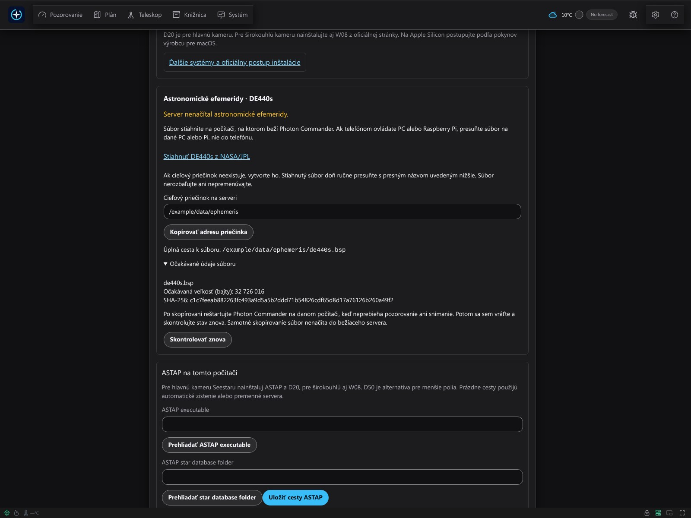
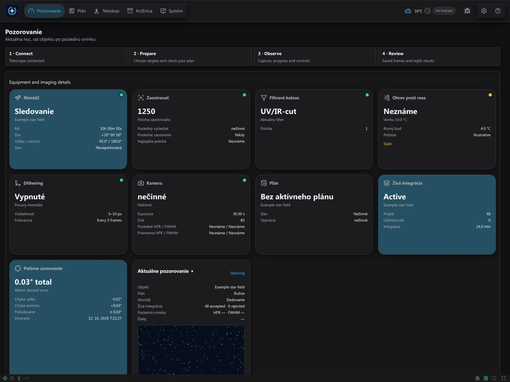
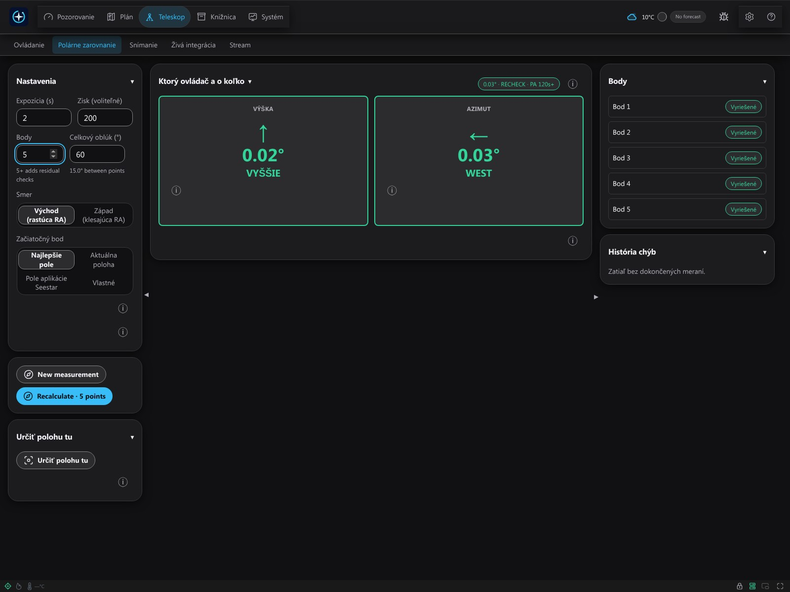
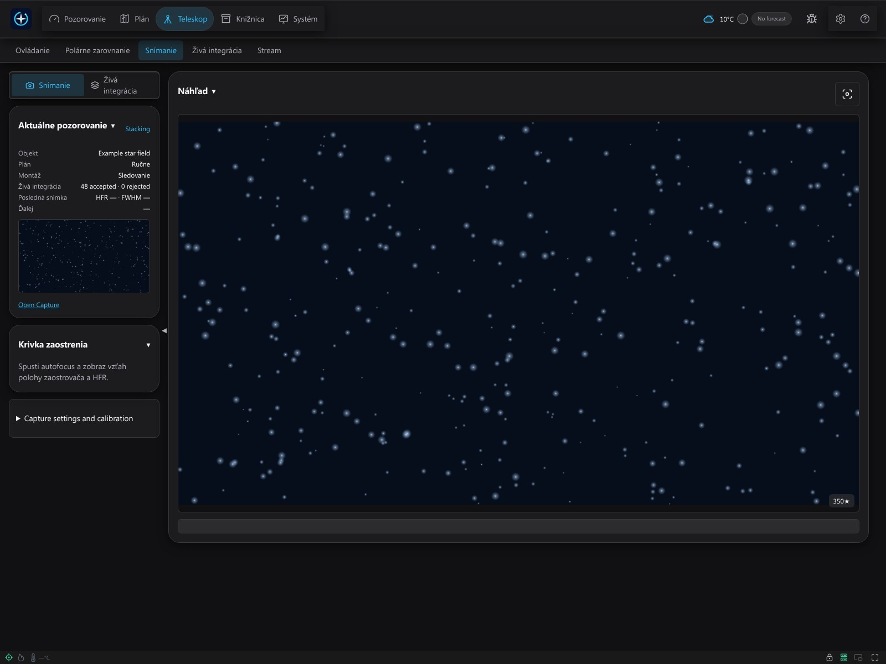
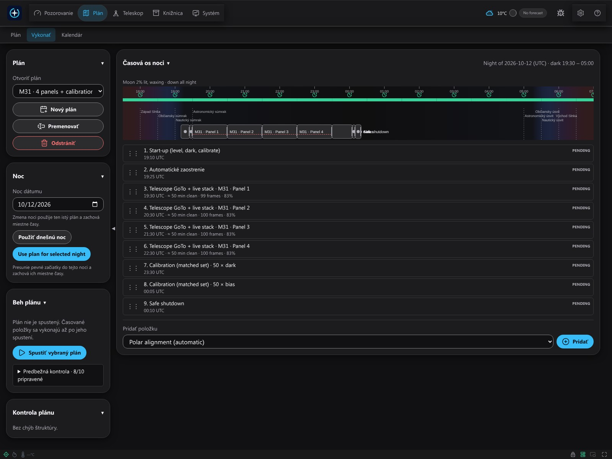
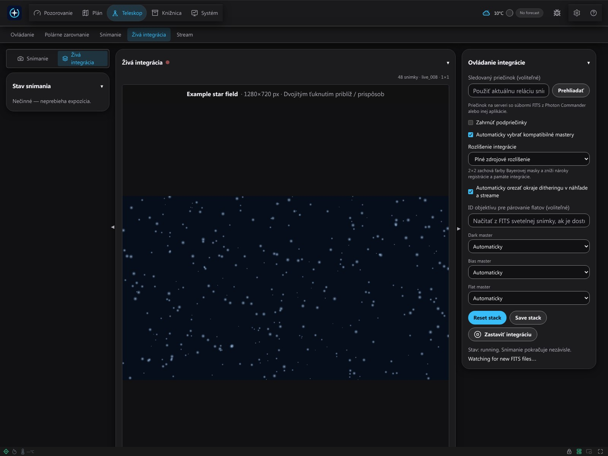
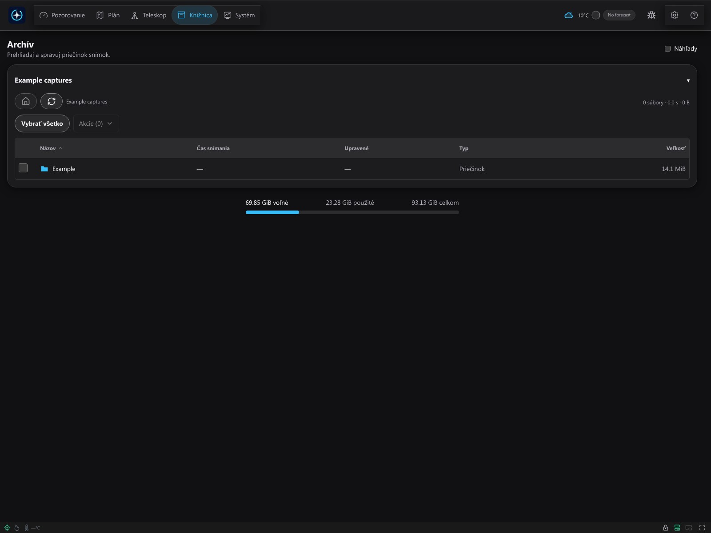

# Začíname s Photon Commander 0.0.1

Návod je určený pre prvé súkromné zostavenia Windows x64 a Raspberry Pi 5 ARM64. Photon Commander je jedna úplná bezplatná aplikácia od Miroslava Bakoša. Návod ani snímky obrazovky nepotvrdzujú kompatibilitu každého systému, firmvéru ani výsledky fyzického pozorovania. Toto vydanie neposkytuje inštalátor pre macOS.

## Inštalácia, spustenie a údržba

Použite [návod pre Windows](installation/windows.sk.txt) alebo [Raspberry Pi](installation/pi.sk.txt). Pred inštaláciou overte dodaný kontrolný súčet SHA-256. Pred aktualizáciou zastavte snímanie, ukončite Photon a zálohujte nastavenia aj snímky. Odinštalovanie zachová zdokumentovaný dátový priečinok; zálohujte aj snímky v inom zvolenom priečinku.

Windows: spustite dodaný inštalátor pre svoj účet, otvorte odkaz aplikácie a http://127.0.0.1:7777. Zatvorenie konzoly backendu ukončí Photon. Raspberry Pi: nainštalujte ARM64 DEB na podporovaný 64-bitový systém a otvorte http://PI-IP:7777; PI-IP nahraďte skutočnou adresou servera Photon, nie teleskopu. Bežný balík používa systémovú službu a /var/lib/photon-commander. Nemiešajte ho s osobitným balíkom pre SSD zariadenie.

## Sprievodca: osem krokov

Otvorte **Sprievodcu nastavením**. Pred tlačidlom **Ďalej** použite **Uložiť** v každom paneli. Potvrdenie kontroly pamätá postup iba v tomto prehliadači; neoveruje pripravenosť hardvéru. Nedokončený postup môžete obnoviť.

**Upozornenie na firmvér:** pred aktualizáciou Seestar požiadajte podporu Photon o potvrdenie modelu, navrhovaného firmvéru a verzie Photonu. Nekompatibilná aktualizácia môže natrvalo znemožniť pripojenie alebo prevádzku, ak sa nedá vrátiť. Vyhľadanie zariadenia samo nepotvrdzuje kompatibilitu.

### 1. Jazyk

1. Vyberte English, Slovenčina alebo Čeština.
2. Skontrolujte, či rozumiete ovládaniu, a pokračujte.

### 2. Sieť a Station Mode

1. Zapnite teleskop a pripojte sa oficiálnou aplikáciou Seestar.
2. Otvorte Wi-Fi nastavenia zariadenia, zapnite Station Mode a vyberte smerovač.
3. Heslo Wi-Fi zadajte **iba v aplikácii výrobcu** a pripojte sa.
4. Telefón pripojte späť k smerovaču. Server Photon aj teleskop musia byť v rovnakej LAN.

Obrázky aplikácie výrobcu sú v [oficiálnom návode](https://www.seestar.com/blogs/tutorial/use-station-mode-screen-mirroring-seestar). Ponuky, pásma Wi-Fi a Ethernet závisia od modelu/firmvéru; pri inom zariadení použite jeho návod.

### 3. ASCOM Alpaca

1. V aplikácii alebo návode výrobcu nájdite ASCOM Alpaca či ovládanie treťou stranou.
2. Zapnite ho, ak ho model a firmvér ponúkajú. Neexistuje rovnaký prepínač pre všetky zariadenia.
3. Ak vybavenie potrebuje externý most Alpaca, nastavte a spustite ho samostatne.
4. Vráťte sa do Photonu a prečítajte stav zariadení.

### 4. Vyhľadanie a pripojenie

1. Prehľadajte LAN a vyberte skutočne nájdené zariadenie.
2. Otestujte adresu a výslovne stlačte **Pripojiť**.
3. Vyberte ponúkanú kameru, montáž a ďalšie zariadenia Alpaca.
4. Overte pripojenie, aktuálnu polohu a upozornenia na schopnosti.

Ak vyhľadávanie nič nenájde, overte napájanie, LAN a izoláciu klientov smerovača. Podľa potreby zadajte skutočnú adresu ručne. Neznáme alebo neaktuálne hodnoty nie sú podkladom na pohyb.

### 5. Vybavenie

1. Vyberte podporovaný model a optiku zodpovedajúce vybaveniu.
2. Prečítajte parametre profilu, stav kalibrácie a upozornenia.
3. Uložte zmeny; pripojenie samo nepotvrdzuje všetky funkcie.

### 6. Pozorovacie miesto

1. Nájdite skutočné miesto teleskopu na verejnej mape, napríklad [Google Maps](https://support.google.com/maps/answer/18539?hl=sk).
2. Pripnite bod alebo kliknite pravým tlačidlom a prečítajte desatinné súradnice.
3. Zadajte najprv šírku, potom dĺžku; zachovajte mínus. Nepoužite polohu telefónu, ak je teleskop inde.
4. Nastavte výšku, časové pásmo a horizont. Uložte a overte miestny aj letný čas.

### 7. Priečinky snímok

1. Vyberte priečinok na počítači so serverom Photon, nie na telefóne.
2. Overte zápis a voľné miesto a stlačte **Uložiť**.
3. Pre systémovú službu Pi použite /var/lib/photon-commander/captures; domovské priečinky blokuje ochrana služby. Príkaz na vytvorenie je v [návode Pi](installation/pi.sk.txt).

### 8. ASTAP a hviezdne databázy

1. Oficiálne odkazy otvorte **na serveri Photon**.
2. Nainštalujte správny ASTAP a D20; pre širokouhlú kameru aj W08.
3. Uložte cesty programu/databázy a overte zistený stav.
4. Skontrolujte panel DE440s. Pri chýbajúcom súbore použite presnú cieľovú cestu servera a reštartujte iba mimo pozorovania/snímania.
5. Znova skontrolujte stav. Dokončenie kontroly nevykoná riešenie polohy ani automaticky nenačíta skopírovaný súbor.

Nasledujúca časť vysvetľuje databázy aj rozdiel zdrojovej a zabalenej verzie.

## ASTAP a astronomické údaje

Na server nainštalujte [ASTAP a databázy](https://www.hnsky.org/astap.htm) z [oficiálneho priečinka](https://sourceforge.net/projects/astap-program/files/). Vyberte Windows x64 alebo Linux ARM64, D20 pre hlavnú kameru a W08 pre širokouhlú kameru. Samotný ASTAP nestačí. V sprievodcovi uložte cestu programu aj databázy a overte zistený stav. Premenné služby SSC_ASTAP_CLI a SSC_ASTAP_DATA_DIR patria do /etc/photon-commander/environment; po zmene reštartujte službu. Pri desktope ukončite a znova spustite backend. Úspešné riešenie polohy vyžaduje vhodnú skutočnú snímku.

Panel DE440s v kroku 8 zobrazuje, či bežiaci server načítal súbor. Pri stave Pripravené nič nesťahujte. Inak použite zobrazený **Cieľový priečinok na serveri** a **Úplnú cestu k súboru**; Kopírovať adresu priečinka kopíruje cieľ servera, nie telefónu. Súbor skopírujte s presným názvom, reštartujte nečinný backend a stlačte **Skontrolovať znova**.

Zdrojová verzia potrebuje [NASA/JPL DE440s](https://naif.jpl.nasa.gov/pub/naif/generic_kernels/spk/planets/de440s.bsp) v data/ephemeris/de440s.bsp vzhľadom na koreň repozitára. Stiahnite súbor na server pred spustením, nie na telefón. Zostavené balíky ho vyžadujú pri balení a obsahujú ho; nepatrí do priečinka snímok. Pri chýbajúcom alebo poškodenom súbore postupujte podľa presnej cesty v chybe servera, opravte inštaláciu alebo zostavte balík so správnym vstupom a reštartujte Photon. Astronomický výpočet ho nesťahuje automaticky. Práva k mapovým snímkam sú samostatné; obmedzenia DSS potvrďte iba vtedy, ak sa vzťahujú na povolené použitie.

## Prvé pozorovanie

Pred pohybom overte statív, priestor, napájanie, počasie a nezávislé zastavenie zariadenia. Obrázok ani uložený profil nie sú dôkazom fyzického zarovnania alebo bezpečnej prevádzky.

### A. Zarovnanie

1. Otvorte Zarovnanie a vyberte postup podporovaný montážou a režimom.
2. Postupujte meraním polárneho zarovnania a čítajte výsledok aj chyby každého kroku.
3. Vykonajte uvedené fyzické úpravy a podľa požiadavky meranie zopakujte.
4. Pokračujte až po kontrole vlastného výsledku; ilustračný obrázok nenahrádza meranie.

### B. Prvý plán

1. Otvorte Plánovanie a vyberte cieľ z katalógu alebo zadajte zamýšľaný cieľ dostupným ovládaním.
2. Overte vybavenie, optiku, dátum a čas pozorovania.
3. Upravte kompozíciu a prípadné panely mozaiky; skontrolujte horizont, rotáciu a upozornenia.
4. Uložte plán, otvorte Plánovanie časovej osi a vyberte uložený plán aj noc.
5. Zostavte a prečítajte časovú os. Pred spustením overte položky, odhadované okná a nesplnené podmienky.
6. Výslovne spustite iba skontrolovaný plán. Sledujte postup a podľa potreby použite zastavenie. Uloženie ani zostavenie nespúšťajú pozorovanie.

### C. Prvá snímka

1. Otvorte Snímanie a overte vybranú kameru a serverový priečinok.
2. Nastavte požadovaný filter, zosilnenie a dĺžku expozície.
3. Spustite jednu expozíciu a počkajte na výsledok. Skontrolujte chyby aj vznik uloženej snímky.
4. Prezrite snímku pred opakovanou sériou. Pred fyzickou zmenou vybavenia alebo aktualizáciou sériu zastavte.

### D. Živé skladanie

1. Otvorte Živé skladanie a skontrolujte cieľ, vstup a možnosti.
2. Výslovne ho zapnite alebo spustite dostupným ovládaním; uložená snímka sama neznamená, že skladanie beží.
3. Sledujte prijaté a odmietnuté snímky aj integráciu. Neznáma kvalita alebo neaktuálne hodnoty nie sú úspešným meraním.
4. Po skončení zastavte snímanie a výsledok pred exportom prezrite.

### E. Knižnica a história

1. Otvorte Knižnicu a vyberte uloženú snímku alebo reláciu.
2. Prezrite náhľad a zaznamenanú kvalitu; exportujte len zamýšľaný výber.
3. Pred odstránením overte vybrané súbory a uchovajte zálohu potrebných originálov.
4. V Kalendári čítajte zaznamenané vykonania. História používa pôvodný vykonaný plán, nie neskoršie úpravy.

## Telefón a vzdialený prístup

V rovnakej LAN otvorte zobrazenú adresu servera alebo http://photon.local:7777 iba ak sa tento názov skutočne oznamuje a funguje. Inak použite skutočnú LAN adresu. photon.local je lokálny názov mDNS, nie internetová adresa. Desktopový balík Windows je predvolene iba lokálny; telefón vyžaduje výslovne nastavený server dostupný v LAN. Spárujte prehliadač zobrazeným QR kódom alebo odkazom; podľa nastavenia zadajte ovládací PIN. Relácia iba na prezeranie nesmie ovládať zariadenie.

Mimo LAN nainštalujte [Tailscale](https://tailscale.com/download) na server aj telefón, pripojte ich k povolenej sieti a podľa Nastavenia → Vzdialený prístup nastavte súkromné HTTPS cez [Tailscale Serve](https://tailscale.com/docs/features/tailscale-serve). Photon iba číta stav; neprihlasuje účet ani nemení pravidlá. Na bežné ovládanie nepresmerujte porty smerovača a nepoužívajte verejný Funnel. Zachovajte nezávislú možnosť miestneho zastavenia alebo vypnutia napájania.

## Problémy a hlásenia

Ak stránka nefunguje, overte backend, adresu, port a firewall; port 7777 môže obsadiť druhý backend. Pi: journalctl -u photon-commander -n 100 --no-pager. Windows: konzola backendu. Pri chýbajúcich snímkach overte serverový priečinok a miesto, pri ASTAP databázu a optiku, pri počasí poskytovateľa a odomknutú systémovú kľúčenku servera. Neaktuálna predpoveď ani posledná hodnota nie sú aktuálny stav.

Cez ikonu chyby opíšte postup, prečítajte pripravené hlásenie a pred Odoslať výslovne potvrďte súhlas. Štruktúrovaná diagnostika vynecháva prihlasovacie údaje, snímky a polohu/nastavenia; vlastný text, obrázky a ručné prílohy nie sú automaticky anonymizované. Pred zdieľaním odstráňte mená, adresy, súradnice, PINy, kľúče a súkromné pozorovania. Ak odoslanie zlyhá, stiahnite hlásenie. Odoslanie nepotvrdzuje správnosť hardvéru.

## Ukážky rozhrania

Ide o snímky skutočného rozhrania Photon Commander s fiktívnymi nastaveniami a ilustračnými odpoveďami API. Hviezdne pole bolo vytvorené pre tieto ukážky. Hodnoty zarovnania, plány, počasie a počty snímok sú ilustračné údaje, nie zaznamenané merania ani dôkaz fyzického výkonu. Cesty priečinkov sú príklady; použite cieľ zobrazený vaším serverom.

### Sprievodca nastavením

Existujúci krok s nástrojmi obsahuje stiahnutie DE440s, cieľový priečinok, kontrolné údaje a pokyny na ručný reštart.

### Prehľad a zariadenia

Prehľad ukazuje ilustračný stav pripojených zariadení; nejde o živé hardvérové spojenie.

### Polárne zarovnanie

Bežné rozhranie zarovnania ukazuje ilustračné korekcie a vyriešené body, nie skutočné meranie.

### Snímanie

Náhľad uloženej snímky zobrazuje syntetické hviezdne pole bez údajov vlastníka a mapových pixelov.

### Časová os plánu

Ilustračná sekvencia štyroch panelov mozaiky obsahuje kalibráciu dark a bias; žiadny plán sa nevykonal.

### Živé skladanie

Ilustračné aktívne skladanie ukazuje syntetické pixely a príkladové počty; neprebehlo žiadne snímanie.

### Knižnica snímok

Knižnica používa fiktívne názvy súborov, záznamy snímok a hodnoty úložiska.
